  
  
  

## 👋 About me

I'm a mobile developer who enjoys taking an idea all the way to the store — from the first screen sketch to the release build. These days I'm at **[RE-OS](https://re-os.com)**, building **Reos**, a real estate CRM that agents, brokers and offices use every day on iOS and Android.

- 📱 **Daily driver:** React Native · TypeScript · Expo
- 🦋 **Also ship with:** Flutter · Dart · Swift
- 🤖 **Lately:** bringing AI-powered features into mobile products
- 🧩 **Care about:** clean architecture, smooth animations and pixel-perfect UI
- 🌍 **Languages:** Turkish · English

## 🛠️ Tech stack

   
   
  

  
  
  
  
  
  
  

## 🚀 What I'm building

  
  

## 📊 GitHub activity

  

  <picture>
    <source media="(prefers-color-scheme: dark)" srcset="https://raw.githubusercontent.com/ArdaKaanOzturk/ArdaKaanOzturk/output/snake-dark.svg" />
    <source media="(prefers-color-scheme: light)" srcset="https://raw.githubusercontent.com/ArdaKaanOzturk/ArdaKaanOzturk/output/snake-light.svg" />
    
  </picture>

## 📌 Featured projects

  
  
  
  

Stats and the contribution snake refresh every day via GitHub Actions.

